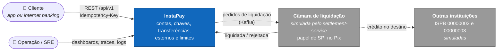
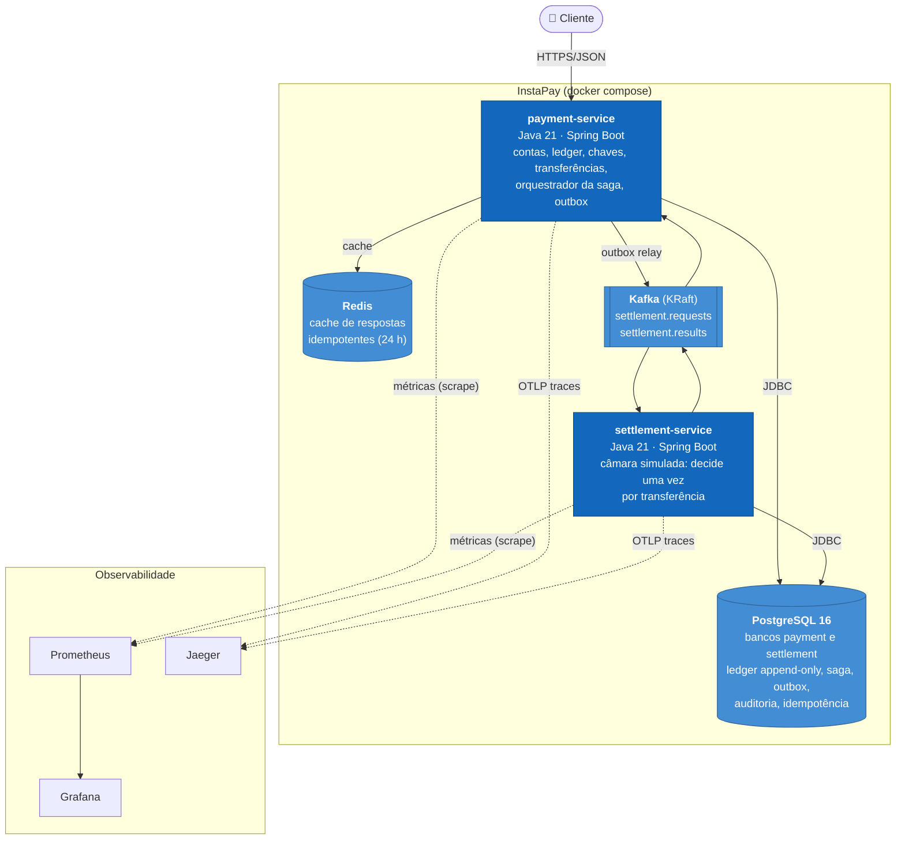

# InstaPay

Plataforma de pagamentos instantâneos inspirada no Pix: contas com saldo derivado de ledger de dupla entrada, chaves de pagamento, transferências internas e entre instituições (saga orquestrada via Kafka), estornos e limites.

> Projeto de portfólio, construído em 10 fases, todas concluídas. Para ver funcionando: `docker compose up --build`, depois `./scripts/saga-demo.sh` e o dashboard em http://localhost:3000.

## Arquitetura

### Contexto (C4 nível 1)



### Containers (C4 nível 2)



- **payment-service:** é dono do dinheiro. Toda movimentação vira lançamento no ledger de dupla entrada, e o saldo nunca é armazenado, só derivado.
- **settlement-service:** simula a câmara. Recebe pedidos, aplica as regras (participante conhecido, prazo `expiresAt`) e responde. Não conhece contas nem saldos.
- **Comunicação entre os serviços:** só por Kafka, com contratos em `messaging-contracts`. Cada serviço tem seu próprio banco.
- **Camadas:** os dois serviços são hexagonais: domínio e aplicação em Java puro, Spring só nos adapters ([ADR-001](docs/adr/0001-arquitetura-hexagonal.md)).

## Critérios de aceite

| Critério | Evidência |
|---|---|
| Teste de concorrência nunca deixa saldo negativo nem divergente | `PessimisticLockingConcurrencyTest` e `OptimisticLockingConcurrencyTest`: 100 threads na mesma conta, saldo final = soma do ledger, nunca negativo ([ADR-002](docs/adr/0002-estrategia-de-locking.md)). Também `RefundAndLimitsApiTest`: 10 estornos simultâneos → exatamente 5 aceitos |
| Mesma `Idempotency-Key` não cria segunda transação | `TransferApiTest`: repetição sequencial, 20 requisições simultâneas com a mesma chave, replay depois de perder o Redis e chave reutilizada com outro corpo → `422` ([ADR-003](docs/adr/0003-idempotencia.md)) |
| Matar o settlement no meio da saga → compensação correta, visível no dashboard | `ExternalTransferSagaTest` (timeout, rejeição, resultado duplicado, liquidação tardia) e [`scripts/saga-demo.sh`](scripts/saga-demo.sh), que derruba o container. No Grafana: *Sagas pendentes* sobe e *Resultados da saga* mostra `timeout` |
| p99 dentro da meta e documentado | [docs/performance](docs/performance/README.md): p99 de 75–166 ms a 500 req/s com a máquina calma; não reproduzível neste notebook compartilhado (305–962 ms em outras rodadas), com o motivo documentado |
| Ledger sempre soma zero | Três camadas: domínio, constraint triggers no commit e testes de propriedade (jqwik), inclusive contra SQL que contorna o domínio. Conferido depois de ~300 mil transferências de carga: `sum(amount_cents) = 0` |
| Cobertura ≥ 85% no domínio | Regra JaCoCo que falha o build. Hoje: payment-domain 99,9% instruções / 97% branches; settlement-domain 100%. Publicado no resumo do CI |

## Stack

Java 21 · Spring Boot 3.5 · PostgreSQL 16 · Flyway · Redis · Kafka (KRaft) · Docker Compose · Testcontainers · JUnit 5 · AssertJ · ArchUnit · Gatling · OpenTelemetry · Micrometer + Prometheus + Grafana · Jaeger · GitHub Actions

## Estrutura

```
build-logic/            convention plugins Gradle (java, domain, spring-boot)
gradle/libs.versions.toml
payment-service/
  payment-domain/       Java puro: entidades, value objects, invariantes
  payment-application/  casos de uso e portas (sem framework)
  payment-adapters/     Spring Boot: web, persistence, messaging, config
settlement-service/     mesma divisão; simula a câmara de liquidação
messaging-contracts/    records dos eventos Kafka
performance-tests/      simulações Gatling (Java DSL)
infra/                  configs de Postgres, Prometheus, Grafana (dashboard provisionado)
http/instapay.http      fluxo completo da API, passo a passo
scripts/                saga-demo.sh (compensação ao vivo), perf.sh (carga)
docs/adr/               Architecture Decision Records
docs/performance/       análise de performance e relatórios Gatling
```

As regras de dependência entre camadas são garantidas pelo grafo de módulos Gradle e por testes ArchUnit — ver [ADR-001](docs/adr/0001-arquitetura-hexagonal.md).

## Como rodar

Pré-requisitos: Docker (com Compose v2) e, para desenvolvimento, JDK 21.

```bash
docker compose up --build        # sobe infraestrutura + os dois serviços
./gradlew build                  # compila, formata (check), SpotBugs, testes, cobertura
./gradlew spotlessApply          # formata o código
```

Os testes de integração usam Testcontainers, então precisam do Docker rodando.

| Serviço | URL |
|---|---|
| payment-service | http://localhost:8080 — health `/actuator/health`, OpenAPI `/swagger-ui.html` |
| settlement-service | http://localhost:8081 |
| Grafana | http://localhost:3000 (admin/admin; anônimo como Viewer) |
| Prometheus | http://localhost:9090 |
| Jaeger | http://localhost:16686 |
| PostgreSQL | localhost:5432 — bancos `payment` e `settlement`, usuário `instapay`/`instapay` |
| Redis | localhost:6379 |
| Kafka | localhost:9092 |

## Domínio (payment-service)

| Pacote | Conteúdo |
|---|---|
| `domain.shared` | `Money` (centavos em `long`, ver ADR-004), `Cpf` (dígitos verificadores), `Ispb`, `DomainException` (código estável → RFC 7807) |
| `domain.account` | `Account` (ACTIVE → BLOCKED ↔ ACTIVE → CLOSED; sem campo de saldo), `AccountId`, `AccountRef`, `AccountHolder` |
| `domain.pixkey` | `PixKey` + `PixKeyType` (CPF, e-mail ≤ 77, telefone E.164, aleatória UUID) em forma canônica |
| `domain.transfer` | `Transfer` (PENDING → COMPLETED \| FAILED; `refund(...)`), `Refund`, `SettlementSaga` (AWAITING → COMPLETED \| COMPENSATED), eventos |
| `domain.limits` | `TransferLimits` (por transação, diário, noturno), `LimitWindows` (dia e noite 20h–6h no fuso local) |
| `domain.ledger` | `JournalEntry` (≥ 2 `Posting`s que somam zero), `SystemAccounts`: `FUNDING` (depósitos), `SETTLEMENT_IN_TRANSIT`, `SETTLEMENT` |

Tempo sempre vem de `java.time.Clock` injetado (garantido por ArchUnit). `Cpf` e `PixKey` mascaram dados pessoais no `toString()` (LGPD).

## API (payment-service, `/api/v1`)

| Método | Caminho | Descrição |
|---|---|---|
| `POST` | `/accounts` | Abre conta (`holderName`, `holderCpf`) |
| `GET` | `/accounts/{id}` | Conta + saldo derivado do ledger |
| `POST` | `/accounts/{id}/deposits` | Depósito (`amount`) |
| `POST` | `/transfers` | Transferência (`debtorAccountId`, `amount` e **um** de: `creditorAccountId` · `creditor {ispb, accountId}` · `creditorKey {type, value}`). `201` interna (concluída); `202` entre instituições (pendente) |
| `GET` | `/transfers/{id}` | Consulta transferência |
| `POST` | `/transfers/{id}/refunds` | Estorno total ou parcial (`amount`, `reason`) |
| `GET` | `/transfers/{id}/refunds` | Estornos, total estornado e saldo estornável |
| `GET` | `/accounts/{id}/limits` | Limites efetivos e uso (hoje / noite atual) |
| `PUT` | `/accounts/{id}/limits` | Personaliza limites (`perTransaction`, `daily`, `nightly`) |
| `POST` | `/keys` | Registra chave (`accountId`, `type`, `value`; `RANDOM` sem `value`) |
| `GET` | `/keys/{type}/{value}` | Consulta chave → conta, instituição, titular (CPF mascarado) |
| `DELETE` | `/keys/{type}/{value}?accountId=` | Exclui chave (só a conta dona) |
| `GET` | `/accounts/{id}/keys` | Chaves da conta |
| `POST` | `/key-claims` | Abre reivindicação (`claimerAccountId`, `keyType`, `keyValue`) |
| `GET` | `/key-claims/{id}` | Consulta reivindicação |
| `POST` | `/key-claims/{id}/confirm` \| `/cancel` \| `/complete` | Ações (`accountId` de quem age) |

- Valores monetários como string decimal (`"30.25"`), ver ADR-004.
- **Toda escrita exige `Idempotency-Key`**; repetição devolve a mesma resposta com `Idempotent-Replayed: true` (ADR-003).
- Erros em RFC 7807 (`application/problem+json`) com `code` estável: `400` formato inválido, `404` não encontrado, `409` conflito transitório, `422` regra de negócio.
- OpenAPI em `/swagger-ui.html`; fluxo completo em [`http/instapay.http`](http/instapay.http).

### Concorrência

Débitos da mesma conta são serializados por `SELECT … FOR UPDATE` (padrão) ou detectados por versão (`instapay.locking.strategy=optimistic`). Comparação medida com 100 requisições simultâneas na mesma conta em [ADR-002](docs/adr/0002-estrategia-de-locking.md): o pessimista é determinístico (50/50 e 100/100), o otimista rejeita 7–16% de transferências legítimas por esgotar retries.

### Transferência entre instituições (saga orquestrada)

```mermaid
sequenceDiagram
    autonumber
    participant C as Cliente
    participant P as payment-service
    participant K as Kafka
    participant S as settlement-service
    C->>P: POST /transfers (creditor.ispb ≠ 00000001)
    P->>P: 1 commit: débito → IN_TRANSIT, saga AWAITING, outbox, auditoria
    P-->>C: 202 PENDING
    P->>K: outbox relay → settlement.requests
    K->>S: SettlementRequest (expiresAt)
    S->>S: decide uma vez (PK transferId); nunca liquida após expiresAt
    S->>K: settlement.results
    K->>P: SETTLED → IN_TRANSIT → SETTLEMENT (COMPLETED)
    K->>P: REJECTED → IN_TRANSIT → cliente (FAILED, compensado)
    Note over P: sem resposta até expiresAt + folga → compensa (settlement.timeout)
```

- Estado persistido em `settlement_saga`; consumidores idempotentes nas duas pontas; detalhes e garantias em [ADR-005](docs/adr/0005-saga-orquestrada.md) e [ADR-006](docs/adr/0006-outbox.md).
- Instituições simuladas pelo settlement: `00000001` (InstaPay), `00000002`, `00000003`. Qualquer outro ISPB é rejeitado.
- Métricas: `instapay_saga_pending`, `instapay_outbox_pending`, `instapay_saga_results_total{outcome}` (completed, compensated, timeout, duplicate, late_settlement).
- Auditoria imutável: `audit_event` (append-only por trigger) recebe cada evento de transferência na mesma transação.
- Demonstração com o settlement derrubado no meio da saga: [`scripts/saga-demo.sh`](scripts/saga-demo.sh).

### Estornos (devolução)

- Vinculados à transferência original; **parciais** permitidos até somar o valor original; prazo de **90 dias**.
- Pagos por quem recebeu (débito com o mesmo lock e checagem de saldo de uma transferência) e creditados a quem pagou; lançamento `REFUND` no ledger e `TransferRefunded` na trilha de auditoria da transferência original.
- Estornos concorrentes da mesma transferência serializam no lock da linha original: 10 estornos simultâneos de R$ 20 sobre R$ 100 → exatamente 5 aceitos (testado).
- Não consomem limites de quem devolve. Só transferências internas: a devolução de uma transferência enviada a outro banco seria iniciada pelo banco recebedor (fluxo de entrada, fora do escopo).

### Limites

| Limite | Janela (America/Sao_Paulo) | Padrão |
|---|---|---|
| Por transação | — | R$ 5.000 |
| Diário | dia corrido (00h–24h) | R$ 10.000 |
| Noturno | 20h–6h, atravessando a meia-noite | R$ 1.000 |

- Configuráveis por conta (`PUT /accounts/{id}/limits`); validados (positivos; por transação e noturno ≤ diário).
- Uso **derivado** das transferências de saída não falhas na janela (índice `(debtor_account, created_at)`), sem contadores que possam divergir; o lock do devedor (ADR-002) torna "verifica e insere" seguro.
- Janelas calculadas no domínio a partir de `Instant` + `ZoneId` (`LimitWindows`); o relógio vem de `java.time.Clock` injetado, e os testes fixam horários como 23:30 e 00:30 para provar que o limite noturno atravessa a meia-noite enquanto o diário zera.
- Simplificação: aumentos de limite valem na hora (no Pix, aumentos levam 24–48 h; reduções são imediatas).

### Chaves de pagamento (regras do DICT, simplificadas)

| Regra | Onde |
|---|---|
| Formato e forma canônica: CPF com DV, e-mail ≤ 77 em minúsculas, telefone E.164, aleatória UUID gerada pelo servidor | `PixKeyType` |
| Chave CPF = CPF do titular; até 5 chaves por conta; só conta ativa | `PixKeyRegistration` |
| Unicidade global, inclusive sob registro concorrente | PK `(type, value)` em `pix_key` |
| **Portabilidade** (mesmo titular, outra conta): doador confirma ou cancela | `KeyClaim` |
| **Reivindicação de posse** (outro titular; só e-mail/telefone): se o doador não contestar em 7 dias, o reivindicador conclui | `KeyClaim` + `Clock` |
| Uma reivindicação aberta por chave; chave com reivindicação aberta não pode ser excluída | índice único parcial + lock de linha |

Simplificações: portabilidade não expira (o DICT cancela após 7 dias sem confirmação); consulta de chave sem rate limit (o DICT limita contra raspagem de dados); sem notificação ao doador.

## Observabilidade

Tudo sobe com o Compose; nada a configurar.

**Dashboard** — Grafana em http://localhost:3000 abre direto em *InstaPay — Visão geral* ([instapay.json](infra/grafana/dashboards/instapay.json), provisionado):

| Bloco | Painéis |
|---|---|
| API de pagamentos | TPS de `POST /transfers`; latência p50/p95/p99 com linha da meta de 200 ms; taxa de erro 5xx; recusas de negócio (4xx) separadas, porque saldo insuficiente não é falha do sistema |
| Saga de liquidação | sagas pendentes e backlog do outbox; resultados por desfecho (`completed`, `compensated`, `timeout`, `duplicate`, `late_settlement`); decisões da câmara; contadores de compensações e de liquidações tardias no período |
| Recursos | conflitos de lock otimista, pool de conexões, lag dos consumidores Kafka, heap |

Para ver a compensação no dashboard: `./scripts/saga-demo.sh` derruba o settlement-service no meio da saga, e o painel mostra as sagas pendentes subindo e depois uma barra `timeout`.

**Tracing** — OpenTelemetry (Micrometer Tracing) → OTLP → Jaeger (http://localhost:16686). Uma transferência entre instituições vira um único trace que atravessa os dois serviços e o Kafka:

```
payment-service     http post /api/v1/transfers        +0 ms     15 ms
  payment-service     settlement.requests publish      +131 ms   15 ms   ← relay do outbox, outra thread
    settlement-service  settlement.requests receive    +153 ms   38 ms
      settlement-service  settlement.results send      +176 ms   12 ms
        payment-service     settlement.results receive +191 ms   18 ms
```

O ponto não trivial é o outbox. O relay publica depois, em outra thread, e por padrão começaria um trace novo. Por isso o `traceparent` da requisição é gravado na linha do outbox (`V6`), e o relay publica sob um span que continua esse trace (`OutboxTracing`). No settlement-service a propagação é a padrão do Spring Kafka (observação no listener e no template). Os latency buckets do Prometheus carregam *exemplars* com o `trace_id`: cada ponto no gráfico de latência abre o trace correspondente no Jaeger.

Fora do trace: scrapes do Prometheus e os polls agendados (relay, job de timeout), que só gerariam ruído (`ObservabilityConfiguration`). Amostragem em 100% para a demo.

**Logs** — JSON (formato Logstash, logging estruturado nativo do Spring Boot), com `traceId` e `spanId` em cada linha:

```json
{"@timestamp":"2026-11-02T14:01:49.94Z","message":"Transfer 84da4765-… REJECTED (unknown_creditor_institution)","logger_name":"…SettlementRequestListener","level":"INFO","traceId":"8fecb54365d82248c9e50549e3cff7f5","spanId":"3f28f391cca9e39d"}
```

O JSON fica ativo no Compose (`LOGGING_STRUCTURED_FORMAT_CONSOLE`); rodando localmente e nos testes o log continua legível em texto.

## Ledger de dupla entrada

Toda movimentação é um `JournalEntry` com lançamentos (`Posting`) de valor com sinal: **negativo = débito** (sai da conta), **positivo = crédito** (entra). Saldo de uma conta = soma dos seus lançamentos — não existe coluna de saldo.

A invariante "soma = 0" é garantida em três camadas:

| Camada | Mecanismo |
|---|---|
| Domínio | `JournalEntry` não pode ser construído desbalanceado, com < 2 lançamentos, conta repetida ou valor zero |
| Banco (`V1__ledger.sql`) | Constraint triggers `DEFERRABLE INITIALLY DEFERRED` validam cada lançamento no COMMIT; triggers rejeitam `UPDATE`/`DELETE`/`TRUNCATE` (append-only — correções são novos lançamentos) |
| Testes | jqwik no domínio (1000 casos por propriedade) e contra Postgres real via Testcontainers (sequências aleatórias de depósitos, transferências e inserts SQL maliciosos que contornam o domínio) |

Persistência via `JdbcTemplate` (sem JPA): o ledger é append-only e não tem grafo de objetos, então ORM não agrega. Saldo usa índice cobrindo `(account_id) INCLUDE (amount_cents)`; na Fase 9 a soma do saldo mediu 0,06 ms por chamada (`pg_stat_statements`), então snapshots de saldo não se justificaram.

## Performance

Gatling ([performance-tests](performance-tests/), Java DSL) contra a stack do Compose: `./scripts/perf.sh <rótulo> load 500 120` ou `spike`. Análise completa, com antes/depois e relatórios HTML, em [docs/performance](docs/performance/README.md).

- **Gargalo:** o pool de conexões, não o Postgres. No baseline, 112 de 133 ms por requisição eram espera por conexão; nenhuma query passa de 0,3 ms.
- **Otimizações:** pool Hikari de 10 para 20, escolhido medindo 10, 20 e 40; e gravação do cache de idempotência depois de enviar a resposta.
- **Meta (p99 < 200 ms a 500 req/s):** atingida com a máquina calma (75 ms, 153 ms; spike a 1.000 req/s com 166 ms), mas não de forma reproduzível neste notebook compartilhado com outros projetos (305 a 962 ms em outras rodadas, sempre com 0 erros). Os detalhes e o ruído estão documentados.

## Qualidade e CI

`./gradlew build` executa, em todos os módulos: Spotless (google-java-format), SpotBugs, testes (unitários, ArchUnit, Testcontainers) e relatórios JaCoCo. Os módulos `*-domain` falham o build com cobertura < 85%.

O GitHub Actions ([ci.yml](.github/workflows/ci.yml)) tem dois jobs:
- **build:** roda o mesmo `./gradlew build`, compila as simulações Gatling, publica a cobertura JaCoCo dos domínios no resumo do job e anexa os relatórios de teste, cobertura e SpotBugs.
- **e2e:** sobe o Compose completo e roda `scripts/saga-demo.sh`, que exercita transferência liquidada, transferência rejeitada e compensação com o settlement derrubado. No fim confere que o ledger soma zero.

## Trade-offs

| Escolha | Ganho | Custo / quando revisitar |
|---|---|---|
| Saldo derivado do ledger, sem coluna de saldo | Uma fonte de verdade; saldo nunca diverge dos lançamentos | Soma por consulta. Medido: 0,06 ms. Com milhões de lançamentos por conta, criar snapshots periódicos (saldo até o lançamento N + delta) |
| Lock pessimista por conta ([ADR-002](docs/adr/0002-estrategia-de-locking.md)) | Determinístico: nenhuma transferência legítima é recusada por conflito | Serializa débitos da mesma conta. Contas muito disputadas pediriam saldo particionado |
| Idempotência com claim no Postgres na mesma transação ([ADR-003](docs/adr/0003-idempotencia.md)) | Exatamente uma execução, mesmo com o Redis fora | A conexão fica presa durante a requisição inteira, e por isso o pool virou o gargalo na Fase 9 |
| Saga orquestrada ([ADR-005](docs/adr/0005-saga-orquestrada.md)) | Estado e compensação num lugar só, visíveis em uma tabela e num gauge | O orquestrador é ponto central; com muitos participantes, a coreografia escala melhor em autonomia |
| Outbox por polling ([ADR-006](docs/adr/0006-outbox.md)) | Simples, sem Debezium; atômico com a transação | Até 200 ms de latência extra e consultas constantes; CDC (Debezium) em volume alto |
| `JdbcTemplate` em vez de JPA | SQL explícito, ledger append-only sem ORM | Mais código de mapeamento |
| Dinheiro em centavos `long` ([ADR-004](docs/adr/0004-modelagem-monetaria.md)) | Exato, rápido, sem `double` (regra ArchUnit) | Uma só moeda; multimoeda pediria `Money(amount, currency)` |
| Monorepo Gradle com dois serviços | Contratos versionados juntos e refatoração atômica | Deploys acoplados no repositório; com times separados, contratos publicados (schema registry) |

## Limitações conhecidas

Simplificações conscientes para o escopo de portfólio. As que estão no código são marcadas com `shortcut:`.

- **Sem autenticação nem autorização:** qualquer chamador age sobre qualquer conta. É o primeiro item de produção (abaixo).
- **Fluxos de entrada fora do escopo:** sem transferência recebida de outra instituição, sem estorno de transferência externa.
- **Sem limpeza de tabelas:** não há job de purge para `idempotency_record` (o Redis expira em 24 h, o Postgres guarda para sempre) nem para `outbox_event` já publicado.
- **Mensagens Kafka inválidas:** sem dead letter topic. O error handler padrão do Spring Kafka tenta 10 vezes e depois descarta a mensagem com log de erro. Se a mensagem descartada for uma resposta `SETTLED`, o payment compensaria por timeout algo que já foi liquidado. Só a conciliação diária pegaria essa divergência.
- **Escopo da chave de idempotência:** é global, não por cliente/credencial.
- **Regras do DICT simplificadas:** portabilidade não expira, consulta de chave sem rate limit, aumento de limite vale na hora (no Pix, 24–48 h).
- **Uma moeda, uma instituição própria:** ISPB fixo `00000001`.

## O que eu faria em produção

**Segurança e conformidade**
- **Autenticação e autorização:** OAuth 2.1 / OIDC com mTLS entre instituições, como no Pix. Autorização por conta: o titular só move a própria conta. Escopos por operação, com step-up (biometria, segundo fator) acima de um valor.
- **Chaves criptográficas em HSM:** assinatura das mensagens trocadas com a câmara (no SPI, mensagens ISO 20022 assinadas com certificados ICP-Brasil) e chaves de criptografia de dados. As chaves nunca ficam em memória da aplicação nem em variável de ambiente; rotação automática.
- **PCI DSS e LGPD:**
  - **Dados sensíveis:** criptografia em repouso (TDE e, para CPF, nome e chaves, criptografia por coluna), tokenização onde der e mascaramento em logs, que já existe.
  - **Acesso:** banco de produção só por bastion auditado; segregação de redes.
  - **Retenção:** política de retenção e anonimização para direito ao esquecimento, conciliada com as obrigações de guarda do Banco Central.
- **Antifraude e limites regulatórios:** análise de risco antes de liquidar (dispositivo, padrão de uso, contas marcadas no DICT) e bloqueio cautelar. Implementar o MED (Mecanismo Especial de Devolução) para fraude.

**Integridade financeira**
- **Conciliação diária automatizada:** três pontas, ledger interno × câmara/SPI × conta reserva no Banco Central. Também ledger × extratos por conta, e invariante global (soma = 0, `SETTLEMENT_IN_TRANSIT` zerado fora de sagas abertas). Divergências viram incidente com dono e prazo; `late_settlement` cai direto nessa fila.
- **Fechamento contábil:** snapshots diários de saldo assinados (hash encadeado) para tornar adulteração detectável, além do append-only por trigger que já existe.
- **Auditoria:** `audit_event` exportado continuamente para armazenamento imutável (object lock / WORM), fora do alcance de quem administra o banco.

**Resiliência e escala**
- **Multi-região:** Postgres com réplica síncrona na mesma região (RPO 0 para o ledger) e assíncrona em outra para desastre. Ativo-passivo para o núcleo financeiro: ativo-ativo em ledger exige particionar contas por região ou consenso distribuído, e o ganho raramente compensa. Kafka com replicação entre regiões (MirrorMaker 2) e failover ensaiado periodicamente.
- **Kafka de produção:** 3+ brokers, `min.insync.replicas=2`, producers idempotentes/transacionais, dead letter topics e schema registry com contratos versionados (Avro ou Protobuf).
- **Escalar o payment-service:** várias instâncias, com o relay do outbox em paralelo por `SKIP LOCKED` (já suportado) ou por CDC. Particionar contas quentes. PgBouncer na frente do Postgres, com o pool dimensionado por medição como na Fase 9.
- **Proteção contra sobrecarga:** rate limiting por cliente e por chave consultada, circuit breakers e backpressure no gateway, timeouts explícitos em toda chamada externa.

**Operação**
- **SLOs com error budget:** disponibilidade e latência p99 por operação, com alertas por burn rate em vez de limiares fixos.
- **Tracing:** tail sampling no OpenTelemetry Collector, guardando todos os traces com erro ou lentos.
- **Testes de resiliência:** chaos engineering recorrente (matar settlement, partição de rede, Postgres lento) para provar compensação e recuperação, como a demo faz localmente.
- **Deploy:** canário com rollback automático por SLO. Migrations sempre compatíveis com a versão anterior (expand/contract), porque ledger não admite downtime de schema.
- **Performance:** testes de carga num ambiente dedicado e com recursos fixos, no pipeline, com orçamento de regressão de p99.

## Decisões (ADRs)

| # | Decisão | Status |
|---|---|---|
| [001](docs/adr/0001-arquitetura-hexagonal.md) | Arquitetura hexagonal | Aceito |
| [002](docs/adr/0002-estrategia-de-locking.md) | Estratégia de locking (pessimista × otimista) | Aceito |
| [003](docs/adr/0003-idempotencia.md) | Idempotência (Redis + Postgres) | Aceito |
| [004](docs/adr/0004-modelagem-monetaria.md) | Modelagem monetária | Aceito |
| [005](docs/adr/0005-saga-orquestrada.md) | Saga orquestrada × coreografada | Aceito |
| [006](docs/adr/0006-outbox.md) | Outbox pattern | Aceito |

## Roadmap

1. ✅ Setup — monorepo, Compose, CI, ADR-001
2. ✅ Domínio puro — Money, AccountId, PixKey, invariantes
3. ✅ Ledger de dupla entrada + Flyway + testes de propriedade (jqwik)
4. ✅ Transferência interna — idempotência e concorrência
5. ✅ Chaves de pagamento
6. ✅ Transferência entre instituições — saga, outbox, compensação
7. ✅ Estornos e limites (incluindo noturno)
8. ✅ Observabilidade — dashboards, tracing ponta a ponta, logs JSON
9. ✅ Performance — Gatling, antes/depois
10. ✅ Documentação final — C4, critérios de aceite, trade-offs, "O que eu faria em produção"
