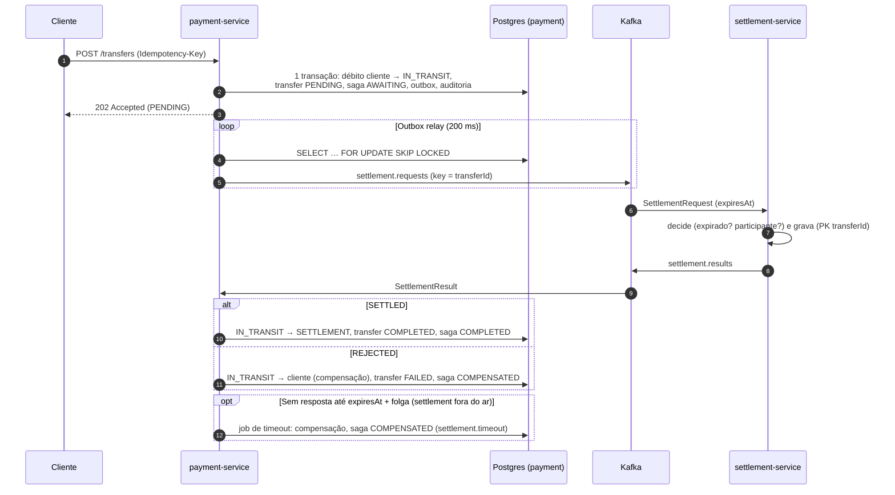

# ADR-005 — Saga orquestrada para transferências entre instituições

- **Status:** Aceito
- **Data:** 2026-11-02

## Contexto

Uma transferência para outra instituição envolve dois serviços com bancos próprios: o `payment-service` (debita o cliente) e o `settlement-service` (simula a câmara de liquidação). Não há transação distribuída; precisamos de consistência eventual com compensação quando a liquidação falha ou não responde — inclusive com o `settlement-service` fora do ar.

## Decisão

**Saga orquestrada pelo `payment-service`**, com estado persistido (`settlement_saga`) e mensagens Kafka:

### Regras que tornam a compensação por timeout segura

1. O pedido carrega `expiresAt` (padrão: 10 s). **O settlement nunca liquida depois de `expiresAt`** — responde `REJECTED expired`.
2. O `payment-service` só compensa por timeout após `expiresAt + folga` (padrão: 5 s), para receber resultados decididos a tempo mas entregues com atraso.
3. Assim, compensar sem resposta não pode coexistir com uma liquidação real — salvo atraso de entrega maior que a folga. Esse caso é detectado (`LATE_SETTLEMENT`: log `ERROR` + métrica `instapay_saga_results_total{outcome="late_settlement"}`), não aplicado, e exige reconciliação.

### Idempotência nas duas pontas

- **payment-service:** a máquina de estados da saga é o deduplicador — resultado para saga já finalizada não altera nada (`DUPLICATE`). Saga e timeout serializam por `SELECT … FOR UPDATE` (o job usa `SKIP LOCKED`).
- **settlement-service:** decisão gravada com PK `transfer_id`; reentrega devolve a decisão gravada (mesmo `decidedAt`), sem decidir de novo.

### Contabilidade

| Etapa | Lançamento |
|---|---|
| Início | cliente → `SETTLEMENT_IN_TRANSIT` |
| Liquidada | `SETTLEMENT_IN_TRANSIT` → `SETTLEMENT` |
| Rejeitada / timeout | `SETTLEMENT_IN_TRANSIT` → cliente |

Invariante verificável: o saldo de `SETTLEMENT_IN_TRANSIT` é a soma das sagas `AWAITING_SETTLEMENT`; com nenhuma pendente, é zero.

## Alternativas consideradas

- **Coreografia** (cada serviço reage a eventos dos outros, sem coordenador): menos acoplamento de comando, mas o estado do fluxo fica espalhado, o timeout não tem dono natural e "onde está a transferência X?" exige correlacionar eventos de vários serviços. Com só dois participantes e um fluxo com compensação e prazo, o orquestrador é mais simples de raciocinar, testar e observar.
- **2PC / XA**: acopla disponibilidade dos dois bancos e do broker; inviável com Kafka e contrário ao requisito de tolerar o settlement fora do ar.
- **Chamada HTTP síncrona ao settlement**: a requisição do cliente passaria a depender da disponibilidade do settlement e o lock da conta ficaria retido durante I/O remoto (ver ADR-002).

## Consequências

- Transferências externas são assíncronas: `202 Accepted` e consulta posterior (`GET /transfers/{id}`).
- O valor fica indisponível para o cliente enquanto a saga está pendente (debitado na hora — não há "saldo negativo temporário").
- Relógios dos dois serviços precisam estar razoavelmente sincronizados (expiração comparada entre serviços); a folga absorve desvios pequenos.
- Mensagens inválidas no tópico (poison pill) são retentadas e descartadas pelo `DefaultErrorHandler`; produção teria DLT.
- Chaves Pix são resolvidas apenas no diretório local; transferência externa exige ISPB + conta (opção A da Fase 5).
